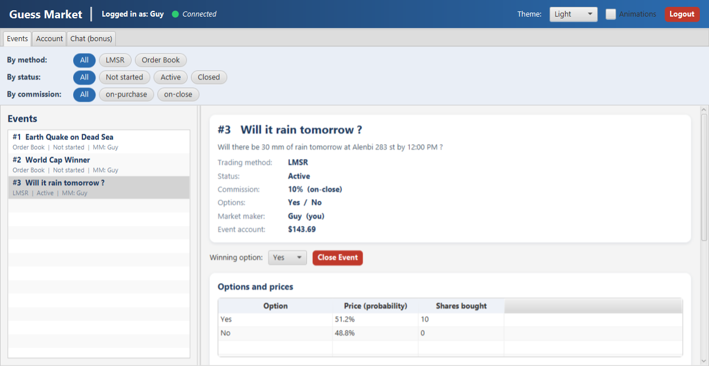
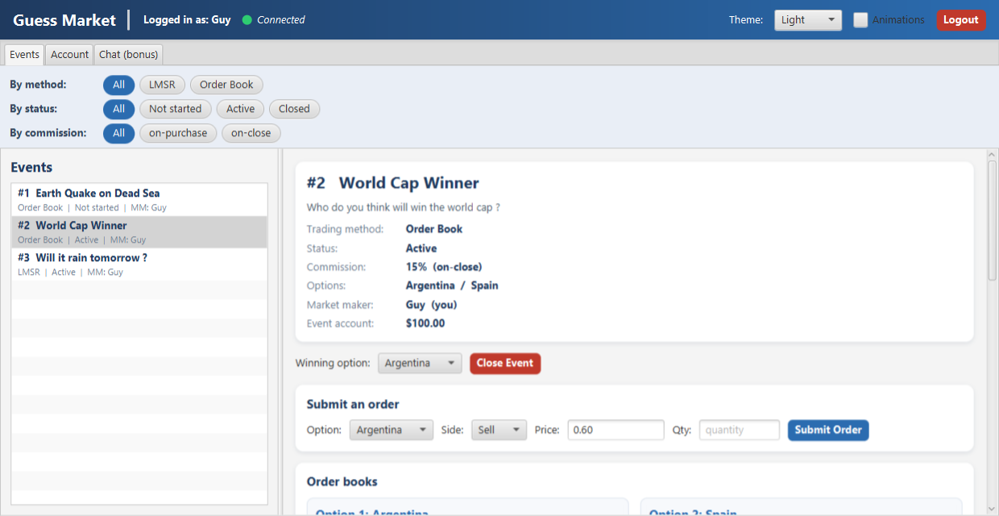
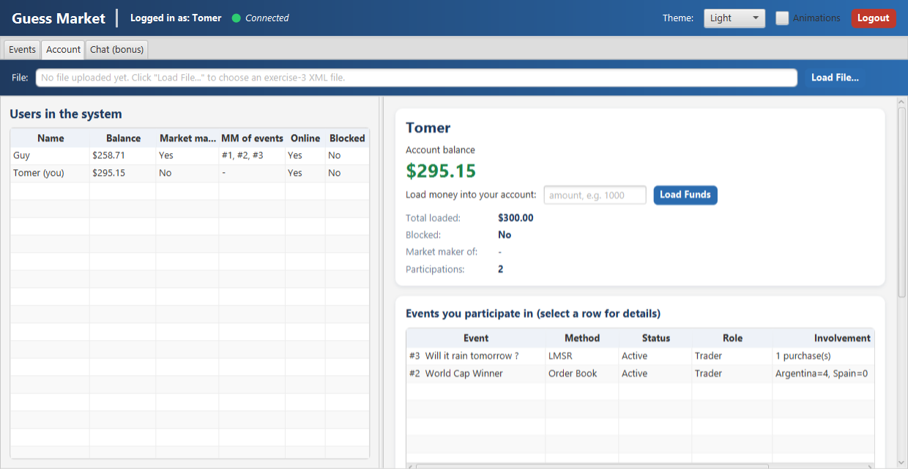
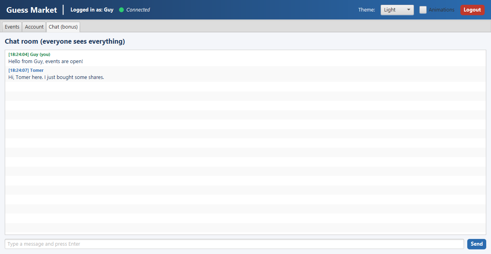
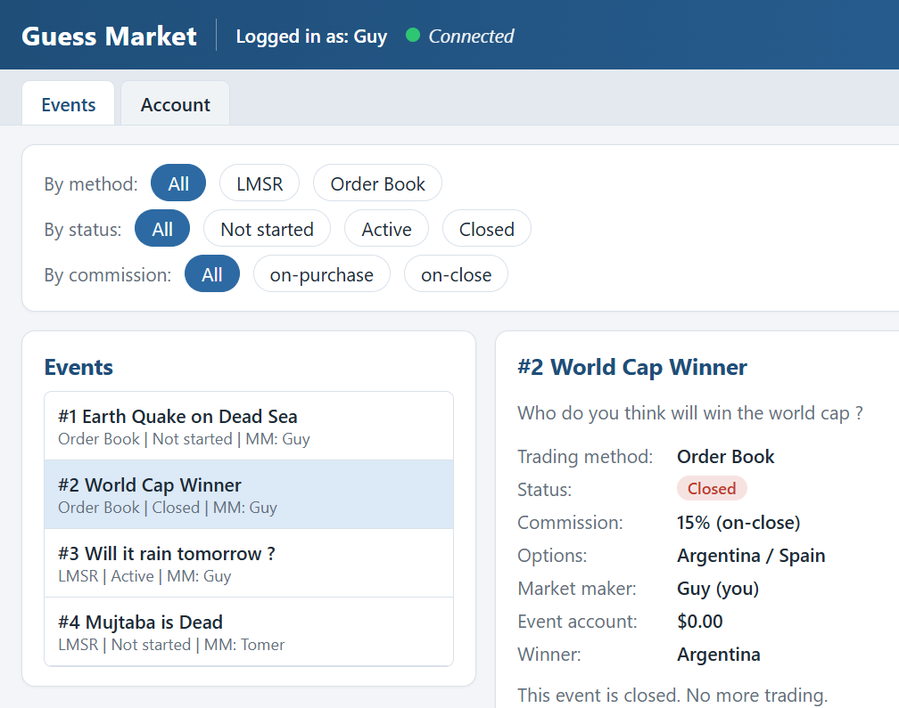
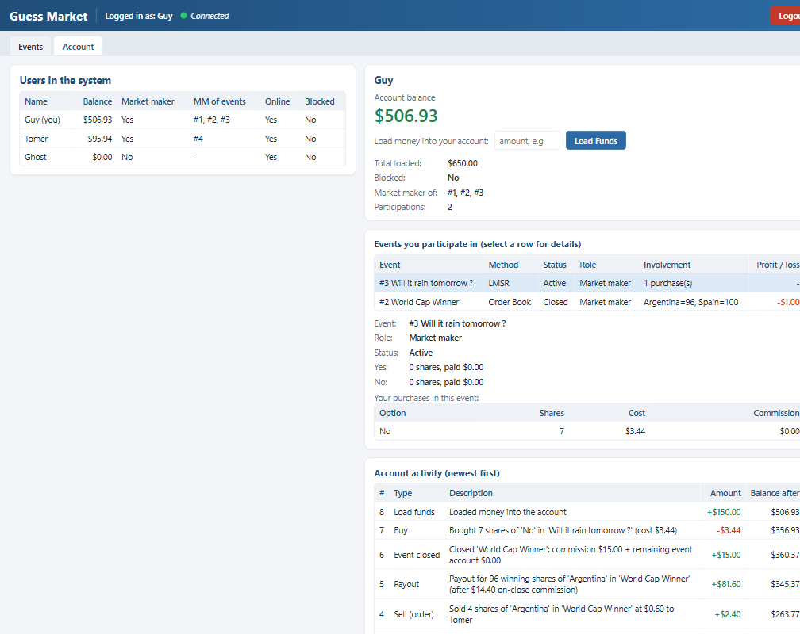
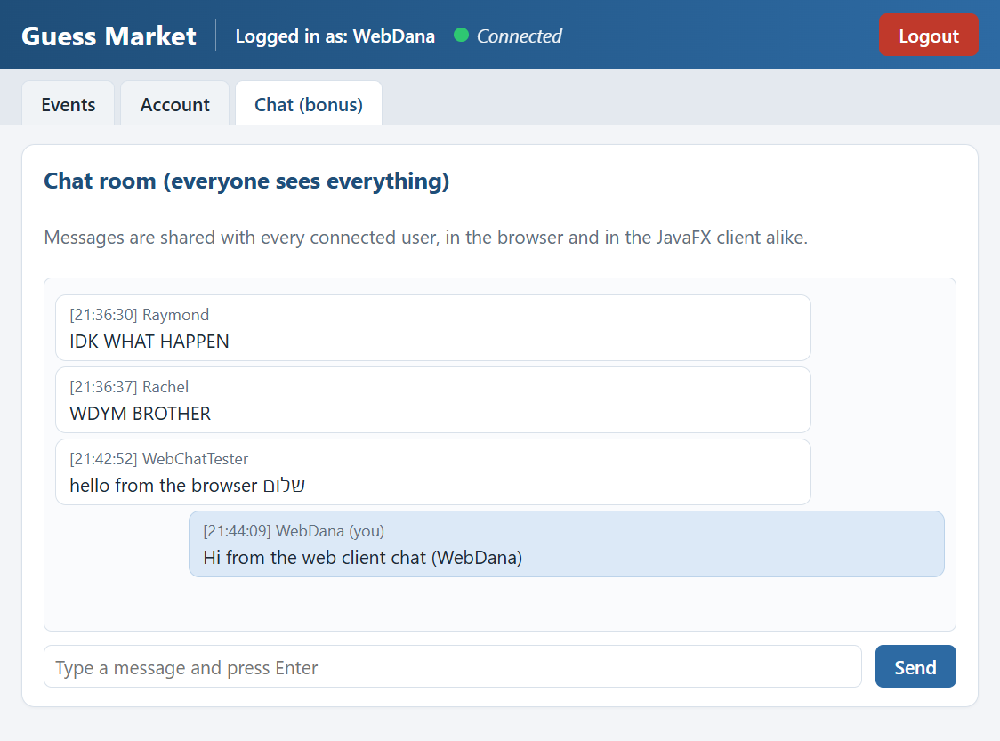
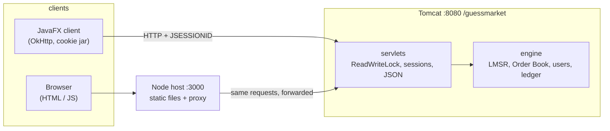

<h1 align="center">Guess Market</h1>

<p align="center">
  A <strong>client-server prediction-market platform</strong>. The trading engine runs inside
  <strong>Tomcat</strong> as a WAR and exposes a JSON API; any number of <strong>JavaFX</strong>
  desktop clients and a <strong>browser client</strong> connect to it, trade against each other in
  real time, and see every change the others make.
</p>

<p align="center">
  
  
  
  
  
</p>

<p align="center">
  
</p>

---

## Overview

**Guess Market** is a prediction market: people trade *YES / NO*-style shares on future events
("Will it rain tomorrow?", "Who wins the World Cup?"). The share price reflects the crowd's estimate
of the outcome's probability; when the event resolves, winning shares pay out and losing shares
expire worthless.

This is the **multi-user, networked** version of the project. Everything that used to live in a
single desktop app is now split in two:

| Side | Technology | Role |
|------|-----------|------|
| **Server** | Java 25, Servlets (Tomcat 10.1), Gson, JAXB | Owns the engine and all state. Validates uploaded event files, runs both market mechanisms, keeps user accounts, ledgers and the chat. |
| **JavaFX client** | JavaFX 25, OkHttp | Login, Events screen, Account screen, Chat. Pulls fresh data from the server every 800 ms and redraws only when something changed. |
| **Web client** | HTML / CSS / vanilla JS, Node (static host + proxy) | Login, Events, Account and Chat screens in the browser, against the very same API. No server changes needed. |

Two market mechanisms are supported, chosen per event:

| Mechanism | How a price is formed | Where the shares come from |
|-----------|----------------------|----------------------------|
| **LMSR** *(Logarithmic Market Scoring Rule)* | A formula prices shares automatically; every buy nudges the price. | An automated market maker mints them; it subsidises the market on opening. |
| **Order Book** *(CLOB)* | Real buy/sell orders match at their resting prices. | Traders resell each other's shares, or **mint** fresh complementary pairs when opposite orders cross the base value. |

---

## Highlights

- **One engine, many clients** - the engine from the desktop version is reused unchanged where it
  mattered; it still knows nothing about HTTP, Tomcat or JavaFX.
- **Real multi-user trading** - users log in by name, load funds, upload event files (the uploader
  becomes the market maker), open and resolve events, and trade against each other. Everyone sees
  everyone's actions within a second.
- **Per-user ledger** - every money movement (load, open, buy, sell, commission, payout, close) is a
  line in the user's account activity, with the balance after each step and a balance chart.
- **Concurrency done once, high up** - a single fair `ReentrantReadWriteLock` in the servlet layer:
  reads run in parallel, mutations are exclusive, the engine stays free of synchronisation code.
- **Cheap polling** - the engine keeps a `version` counter; every list/details response carries it,
  so clients redraw only on change and never lose the user's selection, typed input or scroll position.
- **Robust uploads** - files are streamed straight from the multipart part into the validator (never
  written to disk) and accepted all-or-nothing; a bad file changes nothing.
- **Chat** - a shared chat room with delta fetching (clients ask only for lines they have not seen).
- **Graceful disconnects** - a name whose client vanished without logging out is released after
  20 seconds of silence, so nobody gets locked out by a crashed window.

---

## Screenshots

**Order-book event** - submit orders, watch both option books and their live statistics:

<p align="center">
  
</p>

**Account screen** - every user in the system, your balance and funds, your participations and ledger:

<p align="center">
  
</p>

<table>
  <tr>
    <td width="50%" valign="top">
      
      <p align="center"><em>Chat room (bonus): everyone sees everything</em></p>
    </td>
    <td width="50%" valign="top">
      
      <p align="center"><em>Web client: the same events, in the browser</em></p>
    </td>
  </tr>
</table>

<table>
  <tr>
    <td width="50%" valign="top">
      
      <p align="center"><em>Web client: the account screen</em></p>
    </td>
    <td width="50%" valign="top">
      
      <p align="center"><em>Web client: the same chat room, browser and JavaFX users talking through the server</em></p>
    </td>
  </tr>
</table>

---

## Architecture



Four modules with one-directional dependencies:

```
GuessMarket-EX3/
├── dto/          gm.dto        DTOs shared by server and clients (the only thing a client depends on)
├── engine/       engine.*      domain logic: api, core, core/mechanism, jaxb, exception
├── server/       gm.server     servlets, utils (lock, sessions, presence), chat; web/WEB-INF/web.xml
├── client/       client.*      JavaFX app: app, login, events, account, chat, common, http
├── web-client/                 Node host (server.js) + public/ (HTML, CSS, JS)
├── samples/                    event files + the XSD used by the tests (course material, not committed)
├── _test/                      engine checks, HTTP smoke test, two-client UI driver
├── build.bat                   compiles everything into dist/
└── run-tests.bat               runs the test suites against a running server
```

- **`dto`** - plain serialisable classes. Gson turns them into JSON on the server and back on the client.
- **`engine`** - passive and framework-free. Invalid files throw `InvalidFileException`; illegal
  operations throw `EngineOperationException`. New here: user registry, `loadFunds`, the
  per-user `Transaction` ledger, cumulative uploads, name uniqueness, and the `version` counter.
- **`server`** - thin servlets. `BaseServlet` checks the session (401 if none), takes the read or
  write lock, maps engine exceptions to 400 and anything unexpected to 500, and always answers JSON.
- **`client`** - the JavaFX UI. The Events screen is the desktop version's screen talking to
  `ServerApi` instead of the engine; the Account screen, login and chat are new. A single background
  `Poller` thread pulls all registered tasks every 800 ms and hands results to the FX thread.
- **`web-client`** - `server.js` serves `public/` and forwards `/guessmarket/*` to Tomcat so the
  browser stays same-origin (cookies work, no CORS, no server changes). No npm packages.

### API

| Method | Path | Purpose |
|-------:|------|---------|
| POST | `/login?username=` | log in (409 if the name is currently connected) |
| POST | `/logout` | log out; balance and roles are kept |
| GET | `/me` | who am I |
| POST | `/upload` | multipart event file; uploader becomes market maker |
| GET | `/events` | all events + version |
| GET | `/events/details?id=` | prices, books, participants, history + version |
| POST | `/events/open?id=` `/events/close?id=&winner=` | market-maker lifecycle |
| POST | `/events/buy?id=&option=&shares=` | LMSR purchase |
| POST | `/events/order?id=&option=&side=&price=&quantity=` | order-book order |
| GET | `/users` `/users/details` | all users / my full account |
| POST | `/users/funds?amount=` | load funds |
| GET / POST | `/chat?version=` `/chat?text=` | chat with delta fetching |

Every error is `{"error": "human readable message"}` with the matching status code.

---

## Build & run

Requires a **JDK 25** on your `PATH` and **Tomcat 10.1** for the server. The JavaFX SDK is expected
in `javafx-sdk-25/` (not committed; download the Windows SDK and unpack it there). Node.js is only
needed for the web client.

```bat
build.bat                       :: dist\guessmarket.war + dist\client\
copy dist\guessmarket.war %CATALINA_HOME%\webapps\   :: deploy (context path /guessmarket)
dist\client\run.bat             :: start a JavaFX client (run it once per user)
web-client\run.bat              :: start the web client host and open http://localhost:3000
```

`tomcat-start.bat` / `tomcat-stop.bat` are development helpers for a Tomcat unpacked into `tomcat/`.

### Tests

```bat
run-tests.bat                   :: engine checks + two HTTP suites (smoke, edge cases + concurrency) against the deployed WAR
run-tests.bat ui                :: also drives two real JavaFX clients off-screen end to end
```

---

## Tech stack

**Java 25** · **JavaFX 25** · **Jakarta Servlets** on **Tomcat 10.1** · **Gson** · **JAXB** · **OkHttp** ·
**Node.js** (built-in modules only) · plain **HTML / CSS / JavaScript**.

## Authors

**Guy Yad Shalom** · **Tomer Yad Shalom**
